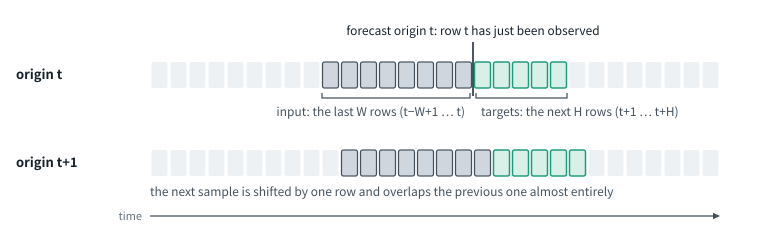
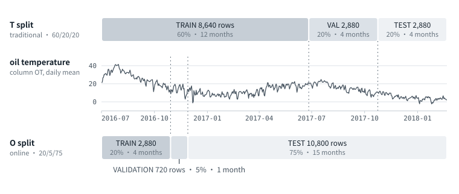
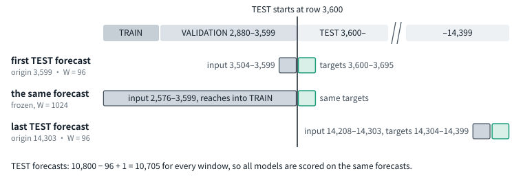
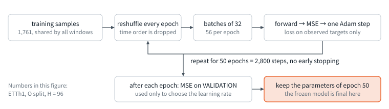
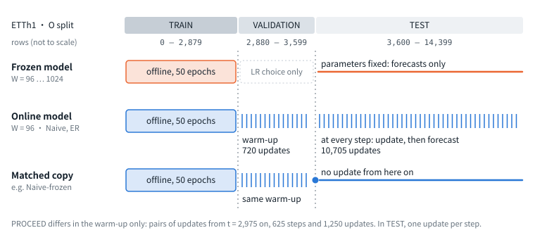
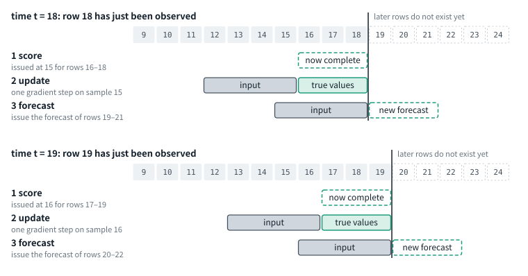
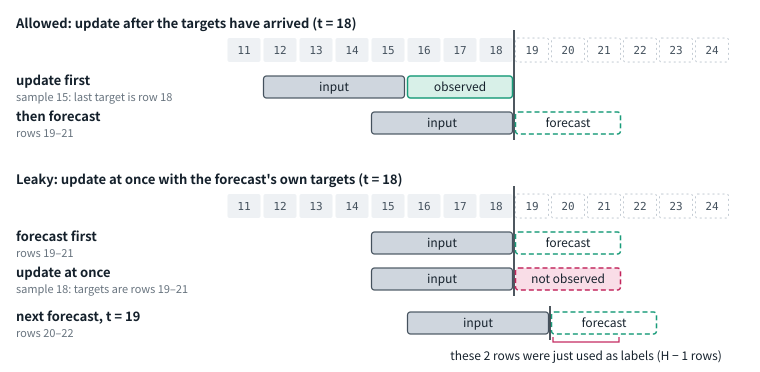
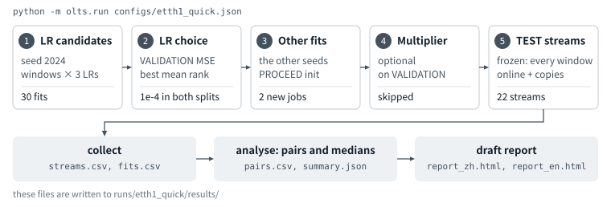

**English** | [简体中文](CONCEPTS.zh-CN.md)

# Primer: how traditional and online forecasting differ

Before you run an experiment, get three things straight: how the data are split, how a model is trained, and how it is used during the test period. This primer goes through them with 8 figures and 3 small demos. Read it first, then do the [exercise plan](STUDENT_TASKS.md).

**You need:**
- a clone of the repository;
- a Python environment with numpy, pandas and torch; the CPU build of torch is enough: `pip install numpy pandas torch`. Only the benchmark itself needs the GPU environment of section 1 of the [guide](GUIDE.md);
- `data/ETTh1.csv`: `bash scripts/download_data.sh ETTh1`.

The three demos run on a CPU; no GPU is needed. With their default settings they take less than a minute together; every extra setting of demo 3 adds half a minute to a minute.

**How to read it:** in each section look at the figure, run the demo, and compare what you see with the output printed here. The numbers should match to the last digit; only the timings differ. Section 7 has the self-check questions: answer them yourself before you open the answers.

**Example:** ETTh1 throughout. One row per hour, 7 variables; the study uses the first 14,400 rows (600 days). The horizon is H = 96 and the online model's input window is W = 96. Rows are counted from 0, as in the code.

## 0. The whole picture

| | Traditional forecasting: frozen model | Online forecasting: online model |
|---|---|---|
| **Data** | T split: the first 60–70% for training, the last 20% for testing | O split: the earliest 20% for training, the last 75% for testing |
| **Training** | Trained offline once on TRAIN, never changed afterwards | The same offline training first. From VALIDATION on, one update whenever all true values of a sample have arrived, up to the last TEST forecast |
| **Inference** | Any order; all forecasts can be computed in one batch | In time order. At every step: score → update → forecast. The true values of a forecast only arrive H steps later |

The split and "is the model updated after deployment" are two separate choices. In the literature, traditional forecasting usually means the T split with a frozen model, and online forecasting the O split with an online model. This benchmark runs all four combinations:

| | Frozen model | Online model |
|---|---|---|
| **T split** | the usual setting in the traditional literature | added by the benchmark |
| **O split** | added by the benchmark | the usual setting in the online literature |

A few words used below:

- **Backbone:** the forecasting model itself, here DLinear and PatchTST.
- **OnlineTSF:** the upstream code base the benchmark builds on, in `third_party/OnlineTSF`. The backbones and the three online methods come from it.
- **Scenario:** one combination of (dataset, backbone, split, H).
- **Stream:** one run of one model through time, up to the last TEST forecast. It yields one TEST MSE.
- **Quick run:** `configs/etth1_quick.json`, that is ETTh1, DLinear, H = 96, seed 2024, both splits.

## 1. What a sample is



- The data are a table: one row per time step, one column per variable.
- The **forecast origin t** is the moment at which row t has just been observed. A forecast issued then reads rows t−W+1 to t (grey boxes, the input) and predicts rows t+1 to t+H (green boxes, the targets).
- The origin moves on by one row at a time, so the number of samples is the number of origins.
- With W = 96 and H = 96 the input holds 96 × 7 numbers and so does the forecast: 4 days each.

## 2. How the data are split



- **T split** (traditional): 8,640 / 2,880 / 2,880 rows, that is 12 / 4 / 4 months.
- **O split** (online): 2,880 / 720 / 10,800 rows, that is 4 / 1 / 15 months.
- Both splits cut the same series, the same 14,400 rows. A month counts as 30 days in the figure.

### Demo 1: print both splits

```bash
python demos/demo1_splits.py
```

```text
ETTh1: 14,400 rows used, 7 variables, horizon H = 96

1. Where the segments are (rows are counted from 0)
   T split (traditional)
      TRAIN      rows      0 -  8,639    8,640 rows  60.0%   2016-07-01 to 2017-06-25
      VALIDATION rows  8,640 - 11,519    2,880 rows  20.0%   2017-06-26 to 2017-10-23
      TEST       rows 11,520 - 14,399    2,880 rows  20.0%   2017-10-24 to 2018-02-20
   O split (online)
      TRAIN      rows      0 -  2,879    2,880 rows  20.0%   2016-07-01 to 2016-10-28
      VALIDATION rows  2,880 -  3,599      720 rows   5.0%   2016-10-29 to 2016-11-27
      TEST       rows  3,600 - 14,399   10,800 rows  75.0%   2016-11-28 to 2018-02-20

2. What the scaler sees (variable 6, column OT; mean and standard deviation of TRAIN only)
   T split: mean   17.128, std   9.176   ->  in these units, TEST has mean -1.34 and std 0.34
   O split: mean   26.679, std   7.783   ->  in these units, TEST has mean -2.00 and std 0.80
   The two splits standardise the same values differently, so their errors are on different scales.

3. How many forecasts each segment yields at H = 96
   A forecast issued at row t reads rows t-W+1 .. t and predicts rows t+1 .. t+H.
   It belongs to a segment when all of its targets lie in that segment; its input may reach back.
                TRAIN, W=96   TRAIN, W=512  TRAIN, W=1024  TRAIN, W=4096   VALIDATION     TEST
   T split            8,449          8,033          7,521          4,449        2,785    2,785
   O split            2,689          2,273          1,761           none          625   10,705

4. The longest window that still leaves 1,024 training samples (the study's minimum)
   T split: W <= 7,521  ->  of 96, 512, 720, 1024, 2048, 4096 the study can use up to W4096
   O split: W <= 1,761  ->  of 96, 512, 720, 1024, 2048, 4096 the study can use up to W1024

   The benchmark gives every window of a scenario the same training samples: origins start at
   common_W - 1, where common_W is the longest window. A short window gets no extra samples.
```

Four things to read off the output:

1. **Where the segments are** (part 1). TRAIN of the O split ends in late October 2016. The model never sees a winter or a spring in training, and is then tested on the following 15 months.
2. **The scaler sees TRAIN only** (part 2). Variable 6 is the column OT, the oil temperature. Its mean is 17.1 in TRAIN of the T split and 26.7 in TRAIN of the O split. The same raw value becomes a different number under the two splits. **The MSE of the two splits is therefore on different scales and must not be compared.**
3. **How many forecasts each segment yields** (part 3). For the same window W96, the O split has less than a third of the T split's training samples (2,689 against 8,449) and almost four times its TEST forecasts (10,705 against 2,785).
4. **The longest usable window** (part 4). The study requires at least 1,024 training samples for the longest window. On ETTh1 this allows up to W1024 in the O split and up to W4096 in the T split.

### What happens at a segment boundary



- A forecast belongs to the segment that holds its targets. Its input may reach back into earlier segments: those rows have all been observed when the forecast is issued.
- Number of TEST forecasts = rows of TEST − H + 1. For ETTh1, O split, H = 96 this is 10,705, whatever the window, so every model is scored on the same forecasts.

## 3. How training differs

### 3.1 Offline training: both kinds of model start with it



- The training samples are shuffled into batches of 32; Adam; 50 epochs; no early stopping; the last epoch is kept.
- VALIDATION is used only to choose the learning rate: from 1e-4, 3e-4 and 1e-3, with seed 2024, rank the three inside each window and take the best mean rank.
- All windows of a scenario are trained on the same samples; a short window gets no extra ones. On ETTh1, O split, these are 1,761 samples, the number in the figure; W96 trained on its own could use 2,689. Details: section 5 of the [protocol](PROTOCOL.md).

### 3.2 Do the parameters change after offline training?



- **Frozen model:** final once offline training ends.
- **Online model:** starts from the same offline-trained parameters. First comes the warm-up: one update per step in time order, and no forecast is kept. During TEST it is updated, then forecasts, at every step.
- **Matched copy** (Naive-frozen, ER-frozen, PROCEED-frozen): the same warm-up as the online model, then frozen just before the first TEST forecast. It differs from the online model only in whether updating continues during TEST.

What each of the three online methods does at a step:

| Method | At every step |
|---|---|
| Naive | one gradient step on the one sample that has just become complete |
| ER | as Naive, plus 8 old samples drawn at random from a buffer of 500; the replay loss has weight 0.2 |
| PROCEED | adds a generator to the backbone. Before forecasting, the generator turns the drift between the current input and the most recent complete sample into adjustments of the backbone's parameters, which are applied for the forecast. The update trains the backbone and the generator's output bias on the sample that has just become complete; the rest of the generator stays fixed |

The warm-up of PROCEED differs from the other two: at every step it makes a pair of updates, first the backbone on the earlier sample, then the generator on the later one. On ETTh1, O split, that is 625 steps and 1,250 updates, against 720 updates for Naive and ER. During TEST all three methods make one update per step.

Who uses the true values of which segment:

| Model | TRAIN | VALIDATION | TEST |
|---|---|---|---|
| Frozen model | trained for 50 epochs | scores only, to choose the learning rate | not used |
| Online model | the same | learning-rate choice; updated sample by sample, in time order, during the warm-up | one update per sample once it is complete |
| Matched copy | the same | as the online model | not used |

The online model uses two more sets of true values than the frozen model: those of VALIDATION, and those of TEST that already lie in the past. That is what online learning is. When you compare the two, remember that they have not seen the same amount of data.

## 4. How inference differs

A frozen model has fixed parameters: each TEST origin is forecast once, in any order. An online model has to walk through time step by step.

### 4.1 Three actions at every step of an online model



1. **Score.** The forecast issued at u = t − H has targets in rows u+1 to t. They have all arrived now, so its error is computed. A forecast is stored when it is issued and cannot be changed afterwards.
2. **Update.** The model is updated with the sample issued at u: input rows u−W+1 to u, targets rows u+1 to t. No update ever uses a row later than t.
3. **Forecast.** The updated model reads rows t−W+1 to t and issues the forecast of rows t+1 to t+H.

### Demo 2: print every step

```bash
python demos/demo2_schedule.py
```

A toy stream with W = 4 and H = 3, the one drawn above. This is the schedule of Naive and ER:

```text
toy stream: TRAIN rows 0-11 | VALIDATION 12-15 | TEST 16-27; window W = 4, horizon H = 3
Row t has just been observed. A forecast issued at t reads rows t-3 .. t and predicts rows t+1 .. t+3.

 t  segment     1 score the forecast issued at  2 update with sample: input -> targets  3 forecast
11  TRAIN       -                               sample 8: 5-8 -> 9-11                   -
12  VALIDATION  -                               sample 9: 6-9 -> 10-12                  -
13  VALIDATION  -                               sample 10: 7-10 -> 11-13                -
14  VALIDATION  -                               sample 11: 8-11 -> 12-14                -
15  VALIDATION  -                               sample 12: 9-12 -> 13-15                rows 16-18  (a)
16  TEST        -                               sample 13: 10-13 -> 14-16               rows 17-19
17  TEST        -                               sample 14: 11-14 -> 15-17               rows 18-20
18  TEST        t=15 (rows 16-18)               sample 15: 12-15 -> 16-18               rows 19-21
19  TEST        t=16 (rows 17-19)               sample 16: 13-16 -> 17-19               rows 20-22
20  TEST        t=17 (rows 18-20)               sample 17: 14-17 -> 18-20               rows 21-23
21  TEST        t=18 (rows 19-21)               sample 18: 15-18 -> 19-21               rows 22-24
22  TEST        t=19 (rows 20-22)               sample 19: 16-19 -> 20-22               rows 23-25
23  TEST        t=20 (rows 21-23)               sample 20: 17-20 -> 21-23               rows 24-26
24  TEST        t=21 (rows 22-24)               sample 21: 18-21 -> 22-24               rows 25-27  (b)
25  TEST        t=22 (rows 23-25)               -                                       -
26  TEST        t=23 (rows 24-26)               -                                       -
27  TEST        t=24 (rows 25-27)               -                                       -
(a) the first TEST forecast; a matched copy is frozen just before this step
(b) the last forecast: one issued later would need rows after the end of the data

warm-up, t = 11 .. 14: 4 updates, no forecast is kept; a matched copy is frozen after them
TEST, t = 15 .. 24: 10 updates, 10 forecasts; at each step the update comes first
scoring: the forecast issued at t is scored at t + 3, so scoring runs from t = 18 to 27

The update at t uses the sample issued at t - 3: its input ends 3 rows before t,
its last target is row t. No update ever uses a row later than t,
and the newest sample the model has learned from is always 3 steps old.
```

With the real row numbers:

```bash
python demos/demo2_schedule.py --dataset ETTh1 --split O --horizon 96
```

```text
ETTh1, O split: TRAIN rows 0-2879 | VALIDATION 2880-3599 | TEST 3600-14399; window W = 96, horizon H = 96
Row t has just been observed. A forecast issued at t reads rows t-95 .. t and predicts rows t+1 .. t+96.

    t  segment     1 score the forecast issued at  2 update with sample: input -> targets    3 forecast
 2879  TRAIN       -                               sample 2783: 2688-2783 -> 2784-2879       -
 2880  VALIDATION  -                               sample 2784: 2689-2784 -> 2785-2880       -
  ...
 3598  VALIDATION  -                               sample 3502: 3407-3502 -> 3503-3598       -
 3599  VALIDATION  -                               sample 3503: 3408-3503 -> 3504-3599       rows 3600-3695  (a)
 3600  TEST        -                               sample 3504: 3409-3504 -> 3505-3600       rows 3601-3696
  ...
 3695  TEST        t=3599 (rows 3600-3695)         sample 3599: 3504-3599 -> 3600-3695       rows 3696-3791
 3696  TEST        t=3600 (rows 3601-3696)         sample 3600: 3505-3600 -> 3601-3696       rows 3697-3792
  ...
14303  TEST        t=14207 (rows 14208-14303)      sample 14207: 14112-14207 -> 14208-14303  rows 14304-14399  (b)
14304  TEST        t=14208 (rows 14209-14304)      -                                         -
  ...
14399  TEST        t=14303 (rows 14304-14399)      -                                         -
(a) the first TEST forecast; a matched copy is frozen just before this step
(b) the last forecast: one issued later would need rows after the end of the data

warm-up, t = 2,879 .. 3,598: 720 updates, no forecast is kept; a matched copy is frozen after them
TEST, t = 3,599 .. 14,303: 10,705 updates, 10,705 forecasts; at each step the update comes first
scoring: the forecast issued at t is scored at t + 96, so scoring runs from t = 3,695 to 14,399

The update at t uses the sample issued at t - 96: its input ends 96 rows before t,
its last target is row t. No update ever uses a row later than t,
and the newest sample the model has learned from is always 96 steps old.
```

- **The warm-up** is the 720 steps from t = 2,879 to 3,598: updates only, no forecast is kept.
- **TEST** starts at t = 3,599 and has 10,705 steps; at each one the model is updated, then forecasts.
- Two details at the boundaries:
  - The first update happens at the last TRAIN row, t = 2,879.
  - At t = 3,599 the model is first updated with the sample issued at 3,503 and then issues the first TEST forecast. This update is counted with TEST; a matched copy is frozen just before it.
- The first TEST forecast is issued at t = 3,599 and scored only at t = 3,695.
- The newest sample the model has learned from at time t was issued 96 steps earlier. The longer the horizon, the further the model lags behind the present.
- PROCEED has the same schedule during TEST. Its warm-up starts at t = 2,975 and makes a pair of updates at every step.

### 4.2 The leak: updating right after forecasting



Some earlier online-forecasting code forecasts step t, updates at once with the true values of that very forecast, and then forecasts step t+1. The OnlineTSF README points this out as information leakage. Two things are wrong with it:

- The update uses rows t+1 to t+H, which do not exist yet at time t.
- Of the H rows that the next forecast has to predict, H − 1 have just been used as training labels.

```bash
python demos/demo2_schedule.py --leaky
```

```text
toy stream: TRAIN rows 0-11 | VALIDATION 12-15 | TEST 16-27; window W = 4, horizon H = 3
Row t has just been observed. A forecast issued at t reads rows t-3 .. t and predicts rows t+1 .. t+3.
LEAKY schedule: after forecasting at t, the model is trained at once on that forecast's own targets.

 t  segment     1 score the forecast issued at  2 forecast  3 update at once with sample: input -> targets
11  TRAIN       -                               -           sample 11: 8-11 -> 12-14  <- NOT OBSERVED YET
12  VALIDATION  -                               -           sample 12: 9-12 -> 13-15  <- NOT OBSERVED YET
13  VALIDATION  -                               -           sample 13: 10-13 -> 14-16  <- NOT OBSERVED YET
14  VALIDATION  -                               -           sample 14: 11-14 -> 15-17  <- NOT OBSERVED YET
15  VALIDATION  -                               rows 16-18  sample 15: 12-15 -> 16-18  <- NOT OBSERVED YET  (a)
16  TEST        -                               rows 17-19  sample 16: 13-16 -> 17-19  <- NOT OBSERVED YET
17  TEST        -                               rows 18-20  sample 17: 14-17 -> 18-20  <- NOT OBSERVED YET
18  TEST        t=15 (rows 16-18)               rows 19-21  sample 18: 15-18 -> 19-21  <- NOT OBSERVED YET
19  TEST        t=16 (rows 17-19)               rows 20-22  sample 19: 16-19 -> 20-22  <- NOT OBSERVED YET
20  TEST        t=17 (rows 18-20)               rows 21-23  sample 20: 17-20 -> 21-23  <- NOT OBSERVED YET
21  TEST        t=18 (rows 19-21)               rows 22-24  sample 21: 18-21 -> 22-24  <- NOT OBSERVED YET
22  TEST        t=19 (rows 20-22)               rows 23-25  sample 22: 19-22 -> 23-25  <- NOT OBSERVED YET
23  TEST        t=20 (rows 21-23)               rows 24-26  sample 23: 20-23 -> 24-26  <- NOT OBSERVED YET
24  TEST        t=21 (rows 22-24)               rows 25-27  sample 24: 21-24 -> 25-27  <- NOT OBSERVED YET  (b)
25  TEST        t=22 (rows 23-25)               -           -
26  TEST        t=23 (rows 24-26)               -           -
27  TEST        t=24 (rows 25-27)               -           -
(a) the first TEST forecast; a matched copy is frozen just before this step
(b) the last forecast: one issued later would need rows after the end of the data

warm-up, t = 11 .. 14: 4 updates, no forecast is kept; a matched copy is frozen after them
TEST, t = 15 .. 24: 10 updates, 10 forecasts; at each step the forecast comes first
scoring: the forecast issued at t is scored at t + 3, so scoring runs from t = 18 to 27

Under this schedule the update at t uses rows up to t + 3.
One step later the model forecasts rows t+2 .. t+4: 2 of these 3 rows were already
used as training targets. The score is then not a forecast score.
```

Every update is marked `NOT OBSERVED YET`.

### Demo 3: frozen, online and leaky, each with a score

```bash
python demos/demo3_offline_vs_online.py
```

```text
ETTh1, O split: TRAIN rows 0-2879 | VALIDATION 2880-3599 | TEST 3600-14399; W = 96, H = 96
offline training: all 2,689 samples of this window, 50 passes in batches of 32 = 4,250 steps, 6.6 s

mode      updates   TEST MSE  MSE vs frozen  ms per forecast
frozen          0     1.0459              -             0.11
online     11,425     1.0060          -3.8%             0.79
leaky      11,425     0.9176         -12.3%             1.10   <- not allowed: uses future targets

10,705 forecasts in every mode, scored on the same rows, in units of the TRAIN standard deviation.
MSE vs frozen: negative = lower error than the frozen model.
Timings differ from run to run; the MSE values do not.
```

How to read it:

- The three modes start from the same trained model and are scored on the same 10,705 forecasts.
- `online` and `leaky` make the same number of updates and differ in two things only: which sample an update uses, and whether the update comes before or after the forecast. The leaky MSE is 8.8% lower than the allowed one (0.9176 against 1.0060). That part comes from looking ahead.
- The column `MSE vs frozen` is the change of the MSE relative to the frozen model; negative means a lower error. Its sign is the opposite of the "gain" of section 5.
- Try two more settings:
  - `--horizon 336`: the longer the horizon, the more the leak flatters the score; the leaky MSE is 13.9% lower than the allowed one.
  - `--split T`: the allowed online model is 1.7% worse than the frozen one, the leaky one looks 0.8% better. The leak reverses the conclusion.
- The last column is the time per forecast. Timings differ between machines and between runs; what is stable is that an online model is slower than a frozen one, because it runs one extra backward pass at every step. In the study an online forecast takes 3.9 times (Naive) to 7.2 times (PROCEED) as long as a frozen W96 forecast.
- The demo has one window only and trains offline on all 2,689 samples that window can use. The benchmark lets all windows share 1,761 (section 3.1).

> **This is a teaching script. Its numbers must not go into a report.** It uses a minimal linear model. The benchmark uses DLinear and PatchTST from OnlineTSF, and its engine is `olts/engine.py` and `olts/worker.py`. In the benchmark, for the same ETTh1, O split, H = 96, the error of Naive with DLinear is 3.1–4.2% higher than that of the frozen W96 model (three seeds), the opposite direction to this demo; with PatchTST it is 2.8–3.7% lower. The direction depends on the model. "Online is better" seen on one small model does not carry over to another model.

## 5. How scores are computed and compared

- **Which forecasts count:** every forecast whose targets all lie in TEST. For ETTh1, O split, H = 96 these are the 10,705 forecasts issued at 3,599 to 14,303.
- **MSE of one stream:** the squared errors over all scored forecasts, all H steps and all variables, divided by the number of observed targets, in units of the TRAIN standard deviation.
- **A pair:** one online stream and one reference stream with the same dataset, backbone, split, H and seed. They are scored on the same forecasts. The reference is either a frozen model of one window or a matched copy.
- **Gain** = (reference MSE − online MSE) ÷ reference MSE. Positive means the online model is better.
- **One cell of a table:** the median of these gains over the pairs, with the number of pairs and the number in which the online model is better. Not the mean: a few online runs diverge, and one such run can drag the mean away.
- **Example:** in the quick run on ETTh1, O split, the MSE of ER is 0.999 and that of the frozen W1024 model is 1.055. Gain = (1.055 − 0.999) ÷ 1.055 = +5.3%.
- Compare inside one split only. The MSE of the O split and of the T split cannot be compared with each other (section 2).

How to turn these numbers into sentences: [how to write the report](REPORTING.md).

## 6. One experiment from start to end



1. **LR candidates:** seed 2024, every window × 3 learning rates, 50 epochs of offline training each.
2. **LR choice:** by the mean rank of the VALIDATION MSE, written to `selections/lr.json`.
3. **Other fits:** the other seeds at the chosen learning rate; PROCEED adds its generator to the W96 model.
4. **Multiplier choice:** optional. The multiplier is the online learning rate divided by the offline one; in the main tables it is fixed at 1. When the config lists several multipliers, online streams on VALIDATION pick one.
5. **TEST streams:** one frozen stream per window; for each online method one online stream and one matched copy.
6. **Wrap-up:** collect the scores, form the pairs and medians, write the draft report in Chinese and English.

The quick run has 54 jobs: 30 fits, 2 PROCEED initialisations and 22 TEST streams. How to run it, read its output and deal with errors: the [guide](GUIDE.md).

## 7. Self-check

Answer first, then open the answers.

1. W = 96, H = 96, origin 3,599. Which rows are the input, which the targets?
2. How many rows do TRAIN, VALIDATION and TEST of ETTh1 have under each split? Why does the O split have no W2048?
3. Why can the MSE of the O split and of the T split not be compared?
4. How many TEST forecasts does ETTh1, O split, H = 96 have? Does the number change when W goes from 96 to 1024?
5. Offline training: what batch size, how many epochs, which epoch is kept, how is the learning rate chosen?
6. What is the difference between frozen W96, Naive and Naive-frozen?
7. Which samples do Naive and ER use at each step?
8. ETTh1, O split, H = 96, at t = 3,695: which forecast is scored? Which sample is used for the update? Which rows does the new forecast cover?
9. What is wrong with a leaky update? In which direction does it push the score of an online method?
10. How is the gain computed? Why does a cell report the median and not the mean?
11. In which steps do the 54 jobs of the quick run fall?

<details>
<summary>Reference answers</summary>

1. Input: rows 3,504–3,599. Targets: rows 3,600–3,695.
2. T split 8,640 / 2,880 / 2,880; O split 2,880 / 720 / 10,800. The study requires at least 1,024 training samples for the longest window. TRAIN of the O split has 2,880 rows, so W must satisfy 2,880 − 96 − W + 1 ≥ 1,024, that is W ≤ 1,761.
3. The scaler sees TRAIN only and TRAIN differs between the splits, so the scales differ. The test period and the amount of training data differ as well.
4. 10,800 − 96 + 1 = 10,705. It does not change: a forecast belongs to the segment that holds its targets, and the input may reach back into earlier segments.
5. Batches of 32, 50 epochs, no early stopping, the last epoch is kept. The learning rate is chosen from 1e-4, 3e-4 and 1e-3: with seed 2024, rank the three by VALIDATION MSE inside each window and take the best mean rank; ties go to the smaller one.
6. Frozen W96 is only trained offline. Naive starts from the same parameters, warms up, and keeps updating at every step of TEST. Naive-frozen has the same warm-up as Naive and is frozen just before the first TEST forecast.
7. Naive uses the one sample that has just become complete. ER uses that sample plus 8 old samples drawn at random from its buffer; the replay loss has weight 0.2.
8. The forecast issued at t = 3,599 is scored; its targets are rows 3,600–3,695. The update uses the sample issued at 3,599: input rows 3,504–3,599, targets rows 3,600–3,695. The new forecast covers rows 3,696–3,791.
9. The update uses rows that had not been observed yet, and H − 1 of the H rows of the next forecast have just been used as training labels. It makes the error of an online method look lower.
10. Gain = (reference MSE − online MSE) ÷ reference MSE. A few online runs diverge and reach many times the frozen error; one such run can drag the mean away, while the median is hardly affected. Report the number of pairs in which the online model is better as well.
11. Step 1: 30 fits. Step 3: 2 new PROCEED initialisation jobs; its other 10 fits were already trained in step 1. Step 5: 22 TEST streams. Steps 2 and 4 create no jobs, and step 4 is skipped in the quick run.

</details>

## 8. Next

- [Exercise plan](STUDENT_TASKS.md): from installation to one small experiment of your own and a report.
- [Guide](GUIDE.md): how to run and how to read the output.
- [Protocol](PROTOCOL.md): the exact rules.
- [How to write the report](REPORTING.md).

The figures are drawn by `docs/figures/make_figures.py`.
