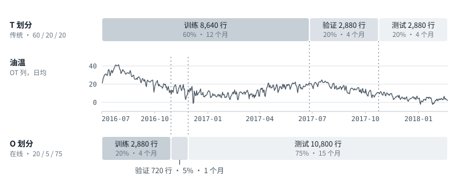
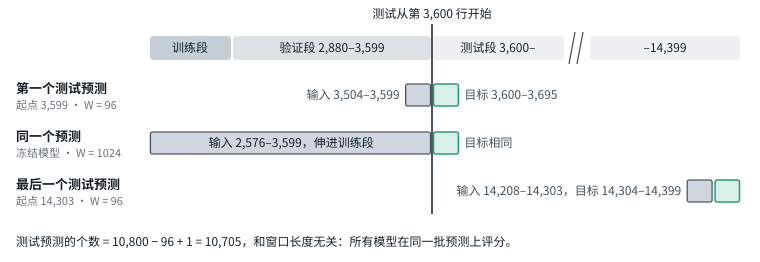
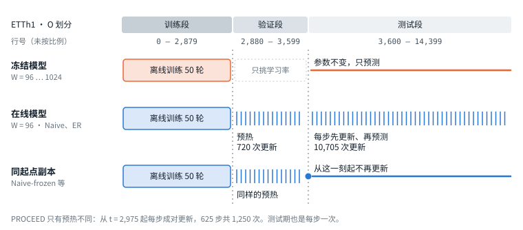
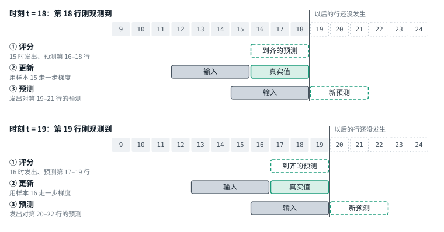
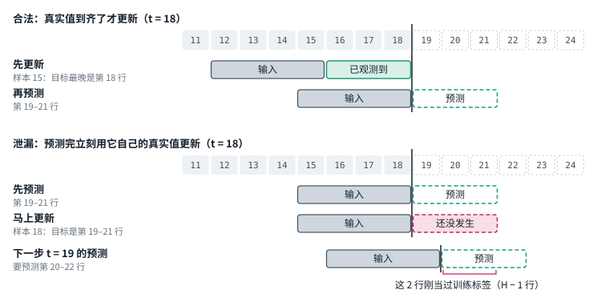
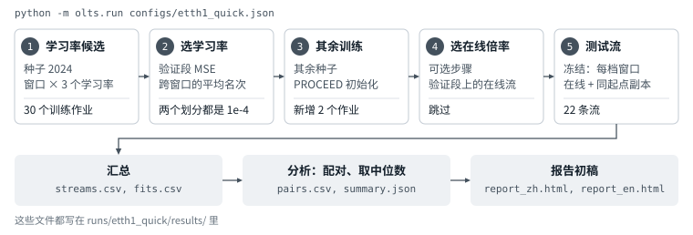

[English](CONCEPTS.md) | **简体中文**

# 入门引导：传统预测和在线预测差在哪

跑实验之前，先弄清三件事：数据怎么切，模型怎么训练，测试时怎么用。这份引导用 8 张图和 3 个小演示把它们讲一遍。读完再做[练习任务书](STUDENT_TASKS.zh-CN.md)。

**需要准备：**
- 克隆好的仓库；
- 一个装了 numpy、pandas 和 torch 的 Python 环境，CPU 版的 torch 就行：`pip install numpy pandas torch`。跑基准本身才需要[上手指南](GUIDE.zh-CN.md)第 1 节的 GPU 环境；
- `data/ETTh1.csv`：`bash scripts/download_data.sh ETTh1`。

三个演示都在 CPU 上跑，不需要 GPU。默认设置加起来不到一分钟；演示 3 每多试一个设置，再加半分钟到一分钟。

**怎么读：** 每一节先看图，再跑演示，把屏幕上的输出和这里贴的对一遍。数字应该一字不差，只有耗时会不同。第 7 节是自测题，先自己答，再展开答案。

**例子：** 统一用 ETTh1。每小时一行，7 个变量，研究用前 14,400 行（600 天）。预测长度 H = 96，在线模型的输入窗口 W = 96。行号从 0 开始，和代码一致。

## 0. 先看全貌

| | 传统预测：冻结模型 | 在线预测：在线模型 |
|---|---|---|
| **数据** | T 划分：前 60%–70% 训练，最后 20% 测试 | O 划分：最早 20% 训练，最后 75% 测试 |
| **训练** | 在训练段上离线训练一次，之后不再改 | 先做同样的离线训练。从验证段开始，每有一个样本的真实值到齐就更新一步，一直到最后一个测试预测 |
| **推理** | 先后顺序无所谓，可以整批算 | 按时间走。每个时刻：评分 → 更新 → 预测。一个预测的真实值要等 H 步才到齐 |

划分方式和“部署后更不更新”是两件独立的事。文献里的传统预测通常是 T 划分加冻结模型，在线预测通常是 O 划分加在线模型。这个基准把四种组合都跑：

| | 冻结模型 | 在线模型 |
|---|---|---|
| **T 划分** | 传统文献里常见的组合 | 基准补上的组合 |
| **O 划分** | 基准补上的组合 | 在线文献里常见的组合 |

后面会用到的几个词：

- **骨干：** 做预测的模型本体，这里是 DLinear 和 PatchTST。
- **OnlineTSF：** 基准用的上游代码库，在 `third_party/OnlineTSF`。骨干和三种在线方法都来自它。
- **场景：** 一组（数据集，骨干，划分，H）。
- **流：** 一个模型按时间从头走到最后一个测试预测的一次运行，产出一个测试 MSE。
- **快速版：** `configs/etth1_quick.json`，也就是 ETTh1、DLinear、H = 96、种子 2024、两种划分。

## 1. 一个样本长什么样


- 数据是一张表：一行是一个时刻，一列是一个变量。
- **预测起点 t** 指第 t 行刚观测到的那一刻。此刻发出的预测读第 t−W+1 到 t 行（灰框，输入），预测第 t+1 到 t+H 行（绿框，目标）。
- 起点每次往后挪一行，所以“样本数”就是“起点数”。
- W = 96、H = 96 时，输入是 96 × 7 个数，要预测的也是 96 × 7 个数，各 4 天。

## 2. 数据怎么切



- **T 划分**（传统）：8,640 / 2,880 / 2,880 行，也就是 12 / 4 / 4 个月。
- **O 划分**（在线）：2,880 / 720 / 10,800 行，也就是 4 / 1 / 15 个月。
- 两种划分切的是同一条序列、同样的 14,400 行。图里一个月按 30 天算。

### 演示 1：把两种划分打印出来

```bash
python demos/demo1_splits.py
```

```text
ETTh1: 14,400 rows used, 7 variables, horizon H = 96

1. Where the segments are (rows are counted from 0)
   T split (traditional)
      TRAIN      rows      0 -  8,639    8,640 rows  60.0%   2016-07-01 to 2017-06-25
      VALIDATION rows  8,640 - 11,519    2,880 rows  20.0%   2017-06-26 to 2017-10-23
      TEST       rows 11,520 - 14,399    2,880 rows  20.0%   2017-10-24 to 2018-02-20
   O split (online)
      TRAIN      rows      0 -  2,879    2,880 rows  20.0%   2016-07-01 to 2016-10-28
      VALIDATION rows  2,880 -  3,599      720 rows   5.0%   2016-10-29 to 2016-11-27
      TEST       rows  3,600 - 14,399   10,800 rows  75.0%   2016-11-28 to 2018-02-20

2. What the scaler sees (variable 6, column OT; mean and standard deviation of TRAIN only)
   T split: mean   17.128, std   9.176   ->  in these units, TEST has mean -1.34 and std 0.34
   O split: mean   26.679, std   7.783   ->  in these units, TEST has mean -2.00 and std 0.80
   The two splits standardise the same values differently, so their errors are on different scales.

3. How many forecasts each segment yields at H = 96
   A forecast issued at row t reads rows t-W+1 .. t and predicts rows t+1 .. t+H.
   It belongs to a segment when all of its targets lie in that segment; its input may reach back.
                TRAIN, W=96   TRAIN, W=512  TRAIN, W=1024  TRAIN, W=4096   VALIDATION     TEST
   T split            8,449          8,033          7,521          4,449        2,785    2,785
   O split            2,689          2,273          1,761           none          625   10,705

4. The longest window that still leaves 1,024 training samples (the study's minimum)
   T split: W <= 7,521  ->  of 96, 512, 720, 1024, 2048, 4096 the study can use up to W4096
   O split: W <= 1,761  ->  of 96, 512, 720, 1024, 2048, 4096 the study can use up to W1024

   The benchmark gives every window of a scenario the same training samples: origins start at
   common_W - 1, where common_W is the longest window. A short window gets no extra samples.
```

对着输出看四件事：

1. **各段在哪**（第 1 部分）。O 划分的训练段只到 2016 年 10 月底，模型训练时没见过冬天和春天，却要在后面 15 个月上测试。
2. **标准化只用训练段**（第 2 部分）。变量 6 是 OT 这一列，也就是油温。它在 T 划分的训练段均值是 17.1，在 O 划分是 26.7。同一个原始值，两种划分下标准化成不同的数。**所以两种划分的 MSE 不在一个尺度上，不能直接比。**
3. **每段能出多少个预测**（第 3 部分）。同样用 W96，O 划分的训练样本不到 T 划分的三分之一（2,689 对 8,449），测试预测却是近四倍（10,705 对 2,785）。
4. **最长能用多长的窗口**（第 4 部分）。研究要求最长的窗口也至少留 1,024 个训练样本，所以 ETTh1 在 O 划分最长只用 W1024，在 T 划分可以到 W4096。

### 段的边界上发生什么



- 一个预测属于哪一段，只看它的目标落在哪。输入可以伸进前面的段：那些行在预测时都已经观测到。
- 测试期的预测个数 = 测试段行数 − H + 1。ETTh1 · O 划分 · H = 96 是 10,705 个，和 W 无关，所以所有模型在同一批预测上评分。

## 3. 训练有什么不同

### 3.1 离线训练：两种模型都先做这一步


- 训练样本打乱，每批 32 个，Adam，训练 50 轮，不早停，取最后一轮。
- 验证段只用来挑学习率：从 1e-4、3e-4、1e-3 里选，用种子 2024，每档窗口里排名，取平均名次最好的。
- 同一场景的所有窗口用同一批训练样本，窗口短的不多拿。ETTh1 · O 划分是 1,761 个，就是图里的数；W96 单独训练本来能用 2,689 个。细节见[协议](PROTOCOL.zh-CN.md)第 5 节。

### 3.2 离线训练之后，参数还变不变



- **冻结模型：** 离线训练完就定型。
- **在线模型：** 从同一份离线训练的参数出发。先预热：按时间每步更新一次，不留预测。测试期每一步先更新、再预测。
- **同起点副本**（Naive-frozen、ER-frozen、PROCEED-frozen）：和在线模型走同样的预热，在发出第一个测试预测之前冻结。它和在线模型只差“测试期还更不更新”。

三种在线方法，每一步做的事：

| 方法 | 每一步 |
|---|---|
| Naive | 取刚到齐的 1 个样本，走一步梯度 |
| ER | 同 Naive，另外从 500 条的缓存里随机取 8 条旧样本一起算，回放损失的权重是 0.2 |
| PROCEED | 给骨干配一个生成器。预测前，生成器按“当前输入”和“最近到齐的样本”之间的漂移，算出骨干参数的调整量，套上去再预测。更新时用刚到齐的样本更新骨干和生成器输出端的偏置，生成器的其余部分不动 |

PROCEED 的预热和另外两种不同：它每一步做一对更新，先用较早的样本更新骨干，再用较新的样本训练生成器。ETTh1 · O 划分上是 625 步、1,250 次更新，Naive 和 ER 是 720 次。测试期三种方法都是每步更新一次。

谁用了哪一段的真实值：

| 模型 | 训练段 | 验证段 | 测试期 |
|---|---|---|---|
| 冻结模型 | 训练 50 轮 | 只算分数，挑学习率 | 不用 |
| 在线模型 | 同上 | 挑学习率；预热时按时间逐个样本更新 | 每个样本到齐后更新一次 |
| 同起点副本 | 同上 | 同在线模型 | 不用 |

在线模型比冻结模型多用了两段真实值：验证段的，和测试期里已经过去的。这是在线学习本来的做法。比较两边时要记得，它们见过的数据不一样多。

## 4. 推理有什么不同

冻结模型的参数不变，每个测试起点各算一次，先后顺序无所谓。在线模型必须按时间一步一步走。

### 4.1 在线模型每个时刻做三件事



1. **评分。** u = t − H 时刻发出的预测，目标是第 u+1 到 t 行，现在全部到齐，算误差。预测在发出时就存下来，之后不能改。
2. **更新。** 用起点 u 的那个样本更新模型：输入是第 u−W+1 到 u 行，目标是第 u+1 到 t 行。任何更新都不会用到第 t 行之后的值。
3. **预测。** 用更新后的模型读第 t−W+1 到 t 行，发出对第 t+1 到 t+H 行的预测。

### 演示 2：把每一步打印出来

```bash
python demos/demo2_schedule.py
```

玩具例子，W = 4、H = 3，和上面的图一一对应。这是 Naive 和 ER 的流程：

```text
toy stream: TRAIN rows 0-11 | VALIDATION 12-15 | TEST 16-27; window W = 4, horizon H = 3
Row t has just been observed. A forecast issued at t reads rows t-3 .. t and predicts rows t+1 .. t+3.

 t  segment     1 score the forecast issued at  2 update with sample: input -> targets  3 forecast
11  TRAIN       -                               sample 8: 5-8 -> 9-11                   -
12  VALIDATION  -                               sample 9: 6-9 -> 10-12                  -
13  VALIDATION  -                               sample 10: 7-10 -> 11-13                -
14  VALIDATION  -                               sample 11: 8-11 -> 12-14                -
15  VALIDATION  -                               sample 12: 9-12 -> 13-15                rows 16-18  (a)
16  TEST        -                               sample 13: 10-13 -> 14-16               rows 17-19
17  TEST        -                               sample 14: 11-14 -> 15-17               rows 18-20
18  TEST        t=15 (rows 16-18)               sample 15: 12-15 -> 16-18               rows 19-21
19  TEST        t=16 (rows 17-19)               sample 16: 13-16 -> 17-19               rows 20-22
20  TEST        t=17 (rows 18-20)               sample 17: 14-17 -> 18-20               rows 21-23
21  TEST        t=18 (rows 19-21)               sample 18: 15-18 -> 19-21               rows 22-24
22  TEST        t=19 (rows 20-22)               sample 19: 16-19 -> 20-22               rows 23-25
23  TEST        t=20 (rows 21-23)               sample 20: 17-20 -> 21-23               rows 24-26
24  TEST        t=21 (rows 22-24)               sample 21: 18-21 -> 22-24               rows 25-27  (b)
25  TEST        t=22 (rows 23-25)               -                                       -
26  TEST        t=23 (rows 24-26)               -                                       -
27  TEST        t=24 (rows 25-27)               -                                       -
(a) the first TEST forecast; a matched copy is frozen just before this step
(b) the last forecast: one issued later would need rows after the end of the data

warm-up, t = 11 .. 14: 4 updates, no forecast is kept; a matched copy is frozen after them
TEST, t = 15 .. 24: 10 updates, 10 forecasts; at each step the update comes first
scoring: the forecast issued at t is scored at t + 3, so scoring runs from t = 18 to 27

The update at t uses the sample issued at t - 3: its input ends 3 rows before t,
its last target is row t. No update ever uses a row later than t,
and the newest sample the model has learned from is always 3 steps old.
```

换成真实的行号：

```bash
python demos/demo2_schedule.py --dataset ETTh1 --split O --horizon 96
```

```text
ETTh1, O split: TRAIN rows 0-2879 | VALIDATION 2880-3599 | TEST 3600-14399; window W = 96, horizon H = 96
Row t has just been observed. A forecast issued at t reads rows t-95 .. t and predicts rows t+1 .. t+96.

    t  segment     1 score the forecast issued at  2 update with sample: input -> targets    3 forecast
 2879  TRAIN       -                               sample 2783: 2688-2783 -> 2784-2879       -
 2880  VALIDATION  -                               sample 2784: 2689-2784 -> 2785-2880       -
  ...
 3598  VALIDATION  -                               sample 3502: 3407-3502 -> 3503-3598       -
 3599  VALIDATION  -                               sample 3503: 3408-3503 -> 3504-3599       rows 3600-3695  (a)
 3600  TEST        -                               sample 3504: 3409-3504 -> 3505-3600       rows 3601-3696
  ...
 3695  TEST        t=3599 (rows 3600-3695)         sample 3599: 3504-3599 -> 3600-3695       rows 3696-3791
 3696  TEST        t=3600 (rows 3601-3696)         sample 3600: 3505-3600 -> 3601-3696       rows 3697-3792
  ...
14303  TEST        t=14207 (rows 14208-14303)      sample 14207: 14112-14207 -> 14208-14303  rows 14304-14399  (b)
14304  TEST        t=14208 (rows 14209-14304)      -                                         -
  ...
14399  TEST        t=14303 (rows 14304-14399)      -                                         -
(a) the first TEST forecast; a matched copy is frozen just before this step
(b) the last forecast: one issued later would need rows after the end of the data

warm-up, t = 2,879 .. 3,598: 720 updates, no forecast is kept; a matched copy is frozen after them
TEST, t = 3,599 .. 14,303: 10,705 updates, 10,705 forecasts; at each step the update comes first
scoring: the forecast issued at t is scored at t + 96, so scoring runs from t = 3,695 to 14,399

The update at t uses the sample issued at t - 96: its input ends 96 rows before t,
its last target is row t. No update ever uses a row later than t,
and the newest sample the model has learned from is always 96 steps old.
```

- **预热**是 t = 2,879 到 3,598 的 720 步，只更新，不留预测。
- **测试期**从 t = 3,599 开始，共 10,705 步，每一步先更新、再预测。
- 两个边界细节：
  - 第一次更新在训练段最后一行，t = 2,879。
  - t = 3,599 这一步，先用起点 3,503 的样本更新，再发出第一个测试预测。这次更新算在测试期里，同起点副本在它之前冻结。
- 第一个测试预测在 t = 3,599 发出，到 t = 3,695 才评分。
- 模型在 t 时刻学到的最新样本，是 96 步之前发出的。预测越长，模型落后“现在”越多。
- PROCEED 的测试期和上面一样。它的预热从 t = 2,975 开始，每步成对更新。

### 4.2 泄漏：预测完立刻更新



早期一些在线预测代码的做法是：预测完第 t 步，立刻用这个预测自己的真实值更新，再去预测第 t+1 步。OnlineTSF 的说明里专门指出这是信息泄漏。错在两处：

- 更新时用的第 t+1 到 t+H 行，在 t 时刻还没发生。
- 下一步要预测的 H 行里，有 H − 1 行刚刚当过训练标签。

```bash
python demos/demo2_schedule.py --leaky
```

```text
toy stream: TRAIN rows 0-11 | VALIDATION 12-15 | TEST 16-27; window W = 4, horizon H = 3
Row t has just been observed. A forecast issued at t reads rows t-3 .. t and predicts rows t+1 .. t+3.
LEAKY schedule: after forecasting at t, the model is trained at once on that forecast's own targets.

 t  segment     1 score the forecast issued at  2 forecast  3 update at once with sample: input -> targets
11  TRAIN       -                               -           sample 11: 8-11 -> 12-14  <- NOT OBSERVED YET
12  VALIDATION  -                               -           sample 12: 9-12 -> 13-15  <- NOT OBSERVED YET
13  VALIDATION  -                               -           sample 13: 10-13 -> 14-16  <- NOT OBSERVED YET
14  VALIDATION  -                               -           sample 14: 11-14 -> 15-17  <- NOT OBSERVED YET
15  VALIDATION  -                               rows 16-18  sample 15: 12-15 -> 16-18  <- NOT OBSERVED YET  (a)
16  TEST        -                               rows 17-19  sample 16: 13-16 -> 17-19  <- NOT OBSERVED YET
17  TEST        -                               rows 18-20  sample 17: 14-17 -> 18-20  <- NOT OBSERVED YET
18  TEST        t=15 (rows 16-18)               rows 19-21  sample 18: 15-18 -> 19-21  <- NOT OBSERVED YET
19  TEST        t=16 (rows 17-19)               rows 20-22  sample 19: 16-19 -> 20-22  <- NOT OBSERVED YET
20  TEST        t=17 (rows 18-20)               rows 21-23  sample 20: 17-20 -> 21-23  <- NOT OBSERVED YET
21  TEST        t=18 (rows 19-21)               rows 22-24  sample 21: 18-21 -> 22-24  <- NOT OBSERVED YET
22  TEST        t=19 (rows 20-22)               rows 23-25  sample 22: 19-22 -> 23-25  <- NOT OBSERVED YET
23  TEST        t=20 (rows 21-23)               rows 24-26  sample 23: 20-23 -> 24-26  <- NOT OBSERVED YET
24  TEST        t=21 (rows 22-24)               rows 25-27  sample 24: 21-24 -> 25-27  <- NOT OBSERVED YET  (b)
25  TEST        t=22 (rows 23-25)               -           -
26  TEST        t=23 (rows 24-26)               -           -
27  TEST        t=24 (rows 25-27)               -           -
(a) the first TEST forecast; a matched copy is frozen just before this step
(b) the last forecast: one issued later would need rows after the end of the data

warm-up, t = 11 .. 14: 4 updates, no forecast is kept; a matched copy is frozen after them
TEST, t = 15 .. 24: 10 updates, 10 forecasts; at each step the forecast comes first
scoring: the forecast issued at t is scored at t + 3, so scoring runs from t = 18 to 27

Under this schedule the update at t uses rows up to t + 3.
One step later the model forecasts rows t+2 .. t+4: 2 of these 3 rows were already
used as training targets. The score is then not a forecast score.
```

每一行的更新都标着 `NOT OBSERVED YET`。

### 演示 3：冻结、在线、泄漏，各跑出一个分数

```bash
python demos/demo3_offline_vs_online.py
```

```text
ETTh1, O split: TRAIN rows 0-2879 | VALIDATION 2880-3599 | TEST 3600-14399; W = 96, H = 96
offline training: all 2,689 samples of this window, 50 passes in batches of 32 = 4,250 steps, 6.6 s

mode      updates   TEST MSE  MSE vs frozen  ms per forecast
frozen          0     1.0459              -             0.11
online     11,425     1.0060          -3.8%             0.79
leaky      11,425     0.9176         -12.3%             1.10   <- not allowed: uses future targets

10,705 forecasts in every mode, scored on the same rows, in units of the TRAIN standard deviation.
MSE vs frozen: negative = lower error than the frozen model.
Timings differ from run to run; the MSE values do not.
```

怎么读：

- 三种用法从同一个训练好的模型出发，在同一批 10,705 个预测上评分。
- `online` 和 `leaky` 的更新次数相同，只差两点：更新用哪个样本，更新在预测之前还是之后。泄漏的 MSE 比合法的低 8.8%（0.9176 对 1.0060），这部分是偷看来的。
- `MSE vs frozen` 一列是 MSE 相对冻结的变化，负数表示误差更低。它和第 5 节的“收益”符号相反。
- 再试两个设置：
  - `--horizon 336`：预测越长，泄漏虚高越多，泄漏的 MSE 比合法的低 13.9%。
  - `--split T`：合法的在线比冻结差 1.7%，泄漏的反而“好” 0.8%，结论的方向都反了。
- 最后一列是每次预测的耗时。耗时每台机器、每次运行都不一样；稳定的是在线比冻结慢，因为它每一步多做一次反向传播。研究里每次预测的耗时是冻结 W96 的 3.9 倍（Naive）到 7.2 倍（PROCEED）。
- 演示只有一个窗口，离线训练用了它能用的全部 2,689 个样本。基准让各窗口共用 1,761 个（第 3.1 节）。

> **这是教学脚本，数字不能写进报告。** 它用的是一个最小的线性模型。基准用的是 OnlineTSF 的 DLinear 和 PatchTST，引擎在 `olts/engine.py` 和 `olts/worker.py`。在基准里，同样是 ETTh1 · O 划分 · H = 96，DLinear 的 Naive 比冻结 W96 的误差高 3.1%–4.2%（三个种子），方向和这个演示相反；换成 PatchTST，Naive 又低 2.8%–3.7%。方向随模型变，在一个小模型上看到的结论不能搬到别的模型上。

## 5. 分数怎么算、怎么比

- **哪些预测计分：** 目标全部落在测试段内的所有预测。ETTh1 · O 划分 · H = 96 是起点 3,599 到 14,303 的 10,705 个。
- **一条流的 MSE：** 所有计分预测、H 步、所有变量上的平方误差加起来，除以观测到的目标个数。用训练段标准化后的尺度。
- **配对：** 一条在线流和一条参照流，数据集、骨干、划分、H、种子都相同。它们在同一批预测上评分。参照流可以是某一档窗口的冻结模型，也可以是同起点副本。
- **收益** = (参照 MSE − 在线 MSE) ÷ 参照 MSE。正数表示在线更好。
- **表格的一格：** 这些配对收益的中位数，外加组数和在线更好的组数。不用均值，因为个别在线运行会训崩，一条就能把均值拖走。
- **例子：** 快速版的 ETTh1 · O 划分，ER 的 MSE 是 0.999，冻结 W1024 是 1.055，收益 = (1.055 − 0.999) ÷ 1.055 = +5.3%。
- 只在同一种划分内部比。O 划分和 T 划分的 MSE 不能互相比（第 2 节）。

怎么把这些数写成句子，见[怎么写报告](REPORTING.zh-CN.md)。

## 6. 一次实验从头到尾



1. **学习率候选：** 种子 2024，每档窗口 × 3 个学习率，各离线训练 50 轮。
2. **选学习率：** 按验证段 MSE 的平均名次选，写进 `selections/lr.json`。
3. **其余训练：** 其余种子用选中的学习率训练；PROCEED 在 W96 的模型上加生成器。
4. **选在线倍率：** 可选。倍率 = 在线学习率 ÷ 离线学习率，主表固定是 1。配置里给了多个倍率时，在验证段上跑在线流来挑。
5. **测试流：** 每档窗口一条冻结流；每种在线方法一条在线流，加一条同起点副本。
6. **收尾：** 汇总分数，配对、取中位数，写出中英文报告初稿。

快速版一共 54 个作业：30 个训练，2 个 PROCEED 初始化，22 条测试流。怎么运行、怎么看输出、出错怎么办，见[上手指南](GUIDE.zh-CN.md)。

## 7. 自测题

先自己答，再展开。

1. W = 96、H = 96、起点是 3,599。输入和目标各是哪些行？
2. ETTh1 在两种划分下，训练、验证、测试各多少行？O 划分为什么没有 W2048？
3. 为什么 O 划分和 T 划分的 MSE 不能直接比？
4. ETTh1 · O 划分 · H = 96 的测试期一共多少个预测？把 W 从 96 换成 1024，这个数变不变？
5. 离线训练每批多少个样本，训练几轮，取哪一轮，学习率怎么选？
6. 冻结 W96、Naive、Naive-frozen 三者差在哪？
7. Naive 和 ER 每一步各用哪些样本？
8. ETTh1 · O 划分 · H = 96，t = 3,695 这一刻：评的是哪个预测？用哪个样本更新？发出的预测覆盖哪些行？
9. 泄漏的更新错在哪？它让在线方法的分数偏向哪一边？
10. 收益怎么算？一格里为什么报中位数，不报均值？
11. 快速版的 54 个作业分别在哪一步？

<details>
<summary>参考答案</summary>

1. 输入是第 3,504–3,599 行，目标是第 3,600–3,695 行。
2. T 划分 8,640 / 2,880 / 2,880，O 划分 2,880 / 720 / 10,800。研究要求最长的窗口也至少留 1,024 个训练样本。O 划分的训练段只有 2,880 行，W 要满足 2,880 − 96 − W + 1 ≥ 1,024，也就是 W ≤ 1,761。
3. 标准化只用训练段，两种划分的训练段不同，标准化后的尺度不同。测的时间段和训练数据量也不同。
4. 10,800 − 96 + 1 = 10,705 个。不变：一个预测属于哪一段只看目标，输入可以伸进前面的段。
5. 每批 32 个，训练 50 轮，不早停，取最后一轮。学习率从 1e-4、3e-4、1e-3 里选：用种子 2024，每档窗口里按验证 MSE 排名，取平均名次最好的，平局取小的。
6. 冻结 W96 只做离线训练。Naive 从同一份参数出发，先预热，测试期继续每步更新。Naive-frozen 和 Naive 走同样的预热，在发出第一个测试预测之前冻结。
7. Naive 只用刚到齐的 1 个样本。ER 用这个样本，再加从缓存里随机取的 8 条旧样本，回放损失的权重是 0.2。
8. 评的是 t = 3,599 发出的预测，它的目标是第 3,600–3,695 行。更新用起点 3,599 的样本，输入第 3,504–3,599 行，目标第 3,600–3,695 行。发出的预测覆盖第 3,696–3,791 行。
9. 更新用到了当时还没观测到的行，下一步要预测的 H 行里有 H − 1 行刚当过训练标签。它让在线方法的误差看起来更低。
10. 收益 = (参照 MSE − 在线 MSE) ÷ 参照 MSE。个别在线运行会训崩，误差能到冻结的很多倍，一条这样的运行就能把均值拖走；中位数几乎不受它影响。同时报几组里有几组在线更好。
11. 第 1 步 30 个训练作业。第 3 步新增 2 个 PROCEED 初始化作业，其余 10 个训练在第 1 步已经做完。第 5 步 22 条测试流。第 2 步和第 4 步不产生作业，第 4 步在快速版里跳过。

</details>

## 8. 接下来

- [练习任务书](STUDENT_TASKS.zh-CN.md)：从装环境到自己做一个小实验、写一份报告。
- [上手指南](GUIDE.zh-CN.md)：怎么运行，怎么看输出。
- [协议](PROTOCOL.zh-CN.md)：全部规则的准确写法。
- [怎么写报告](REPORTING.zh-CN.md)。

图由 `docs/figures/make_figures.py` 生成。
